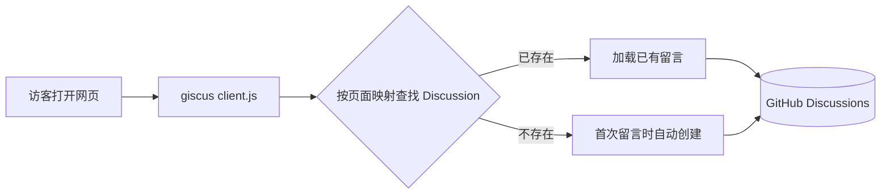

# lechuang-comments
# lechuang-comments

[](https://giscus.app/zh-CN) [](#)

> 给网站页面底部加一个留言 / 评论区的轻量工具，基于 [giscus](https://giscus.app/zh-CN) + GitHub Discussions。
> **不需要后端、不需要数据库**，网站侧只要引入一段 `<script>`，留言全部存进本仓库的 Discussions 里。

本仓库用于集中维护「网站留言区」的接入配置与使用说明，不存放网站业务代码。

---

## ✨ 为什么用它

- **零运维**：无需服务器、数据库或第三方评论 SaaS，评论数据归你自己（GitHub Discussions）。
- **开箱即用的能力**：GitHub 账号登录、Markdown、表情回应、引用回复、邮件通知、自动拉取新评论与编辑。
- **好管**：垃圾评论可以直接在 Discussions 里删除、隐藏或锁定讨论。
- **跟着网站风格走**：支持明暗主题自动跟随、自定义主题 CSS、简体中文界面。
- **免费、无广告、无追踪**。

> ⚠️ 一个取舍：访客需要 **GitHub 账号** 才能留言。如果你的读者大多没有 GitHub 账号，这点需要提前考虑。

## 🧩 工作原理



giscus 通过 GitHub Discussions 搜索 API，按你选择的映射方式（默认是页面路径 `pathname`）查找与当前页面关联的 Discussion；找不到时，**在第一条留言或第一个表情回应产生时自动创建**。所以刚接入时页面显示为空是正常的。

---

## ✅ 一次性准备（约 5 分钟）

1. **仓库设为公开（Public）** —— 私有仓库访客看不到 discussion。
2. **开启 Discussions**：`Settings → General → Features → ☑ Discussions`。
3. **建一个分类**：在 `Discussions → Categories` 新建，例如 `留言` 或 `Comments`，**推荐选 Announcements（公告）类型**，这样新 discussion 只能由仓库维护者和 giscus 创建，避免有人手动乱开帖。
4. **安装 [giscus app](https://github.com/apps/giscus)**：只授权 `LeChuangDev/lechuang-comments` 这一个仓库即可，否则访客无法评论。
5. **生成配置**：打开 [giscus.app/zh-CN](https://giscus.app/zh-CN)，填入 `LeChuangDev/lechuang-comments` 并选择上面的分类，页面会自动给出 `data-repo-id` 和 `data-category-id`（不要手填猜测值）。

---

## 🚀 接入网站

把下面这段放到**文章 / 页面内容的末尾**（也就是你希望留言区出现的位置）。如果页面上已有一个 `class="giscus"` 的元素，留言区会渲染到那里；否则就渲染在 `<script>` 所在位置。

```html
<!-- 可选：指定留言区容器，便于用 CSS 控制宽度和间距 -->
<div class="giscus" style="max-width: 820px; margin: 3rem auto;"></div>

<script src="https://giscus.app/client.js"
        data-repo="LeChuangDev/lechuang-comments"
        data-repo-id="YOUR_REPO_ID"
        data-category="留言"
        data-category-id="YOUR_CATEGORY_ID"
        data-mapping="pathname"
        data-strict="0"
        data-reactions-enabled="1"
        data-emit-metadata="0"
        data-input-position="bottom"
        data-theme="preferred_color_scheme"
        data-lang="zh-CN"
        data-loading="lazy"
        crossorigin="anonymous"
        async>
</script>
```

需要替换的 4 个值：

| 占位符 | 从哪来 |
| --- | --- |
| `YOUR_REPO_ID` | giscus.app 填完仓库后自动生成，形如 `R_kgDO...` |
| `YOUR_CATEGORY_ID` | giscus.app 选完分类后自动生成，形如 `DIC_kwDO...` |
| `data-category` | 你在第 3 步创建的分类**名称**，必须与仓库里的完全一致 |
| `data-repo` | 若改用别的仓库承接评论，改成 `owner/repo` |

部署后打开页面，用 GitHub 账号发一条留言测试：仓库 Discussions 里应当自动多出一条以页面路径命名的讨论。

---

## ⚙️ 常用配置项

| 属性 | 作用 | 建议 |
| --- | --- | --- |
| `data-mapping` | 页面 ↔ discussion 的匹配方式 | `pathname`（路径改版会换讨论，见下文） |
| `data-strict` | `1` 开启严格标题匹配，避免相似标题串帖 | 新站可用 `1`，已有讨论需先迁移，默认 `0` |
| `data-reactions-enabled` | 是否显示主帖的 👍 ❤️ 等表情回应 | `1` |
| `data-input-position` | 评论框位置：`top` / `bottom` | 长评论区用 `top` 更顺手 |
| `data-theme` | 主题，详见下节 | `preferred_color_scheme` |
| `data-lang` | 界面语言 | `zh-CN` |
| `data-loading` | `lazy` 滚到附近才加载 | 长页面建议保留 |
| `data-emit-metadata` | `1` 时向父页面推送讨论元数据 | 一般 `0` |

### 页面映射怎么选（`data-mapping`）

| 值 | 匹配依据 | 适用 |
| --- | --- | --- |
| `pathname` | 页面路径 `/posts/hello` | 默认，最常用 |
| `url` | 完整 URL | 多域名时要区分 |
| `title` / `og:title` | `<title>` / `og:title` | 路径常变但标题稳定 |
| `specific` | 固定字符串 | 整站共用一个留言区 |
| `number` | 指定 discussion 编号 | 单页专用，**不会自动创建讨论** |

> 💡 若网站改版导致 URL 变化，已有留言会「看起来消失」。改版时建议保留旧路径，或把 `title` / `og:title` 作为映射，或到 Discussions 里手动修改讨论标题使其与新映射匹配。

### 主题与深色模式

`preferred_color_scheme` 会跟随访客系统偏好自动切换明暗，最省事。如果网站有自己的主题切换按钮，可以在切换时给 iframe 发一条消息，无需刷新页面：

```js
function syncGiscusTheme(isDark) {
  const iframe = document.querySelector('iframe.giscus-frame');
  iframe?.contentWindow?.postMessage(
    { giscus: { setConfig: { theme: isDark ? 'dark' : 'light' } } },
    'https://giscus.app'
  );
}
```

也可以把 `data-theme` 填成一个 CSS 文件 URL 来完全自定义配色（只加载你信任的样式文件）。容器可用 `.giscus` 和 `.giscus-frame` 选择器调整宽度、边距。

---

## 🛠 不同网站怎么放

- **纯 HTML / 静态站**：放进公共 `footer.html` 或每篇文章模板的末尾即可。
- **Hexo / Hugo / VitePress / VuePress**：放到文章模板或布局的 `post-after` / `footer` 片段，注意只在文章页输出，别把同一段塞进首页。
- **React / Vue / Svelte 等 SPA**：推荐用官方 [giscus-component](https://github.com/giscus/giscus-component)；或自行在组件挂载时创建 `<script>`、卸载时移除。**路由切换后需要重新挂载或用 `setConfig.term` 更新映射**，否则会一直显示上一篇文章的留言。
- **多站点共用一个仓库**：给每个站点用不同的 `data-category`，或改用 `data-mapping="specific"` 加不同字符串区分。

---

## 🔒 只允许自己的域名加载（推荐）

在**本仓库根目录**新建 `giscus.json`，限制哪些站点能用这个仓库的 Discussions，并顺便设置评论排序：

```json
{
  "origins": ["https://你的域名.com"],
  "originsRegex": ["http://localhost:[0-9]+"],
  "defaultCommentOrder": "oldest"
}
```

- `origins` / `originsRegex`：与页面的 `window.origin` 做精确 / 正则匹配，都不匹配时 giscus 拒绝加载；留空则不限制。
- `defaultCommentOrder`：`oldest`（默认，早→晚）或 `newest`（新→旧）。

本地调试常用 `localhost`，所以保留上面那条 `originsRegex` 比较方便。

---

## ❓ 常见问题

| 现象 | 排查 |
| --- | --- |
| 留言区一片空白 / 控制台报权限错 | 仓库是否公开、Discussions 是否开启、giscus app 是否已安装并授权本仓库 |
| 提示仓库或分类无效 | `data-repo-id` / `data-category-id` 必须从 giscus.app 生成；`data-category` 名称要与仓库分类完全一致 |
| 本地能显示、线上不显示（或相反） | 检查 `giscus.json` 的 `origins` 是否包含线上域名（要带协议，不带路径和末尾斜杠） |
| 访客说「没法评论」 | 需要先登录 GitHub 并授权 giscus app；也可以直接在对应 Discussion 里回复 |
| 换了域名 / 改了路径，旧评论不见了 | 映射值变了，按上文「页面映射」一节调整讨论标题或映射方式 |
| 想关掉某页留言 | 删掉该页的 `<script>`；或直接锁定对应 Discussion |

---

## 📁 关于本仓库

当前仓库只包含这份说明文档。可选地把 `giscus.json`（域名白名单）也提交进来统一管理。网站本身的代码与样式不在这里维护。

## 🙏 致谢

评论能力由开源的 [giscus](https://github.com/giscus/giscus) 提供；更完整的参数说明见 [giscus 高级用法](https://github.com/giscus/giscus/blob/main/ADVANCED-USAGE.md) 与 [配置页](https://giscus.app/zh-CN)。

维护：[LeChuangDev 樂創](https://github.com/LeChuangDev)
